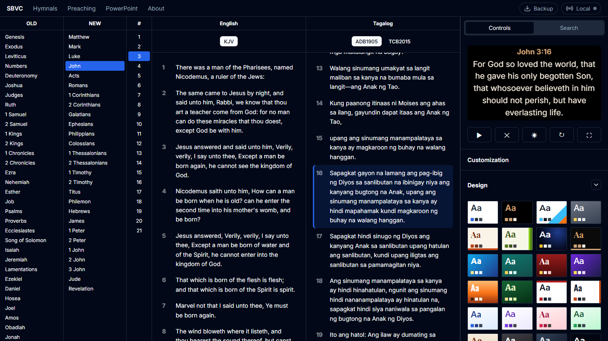
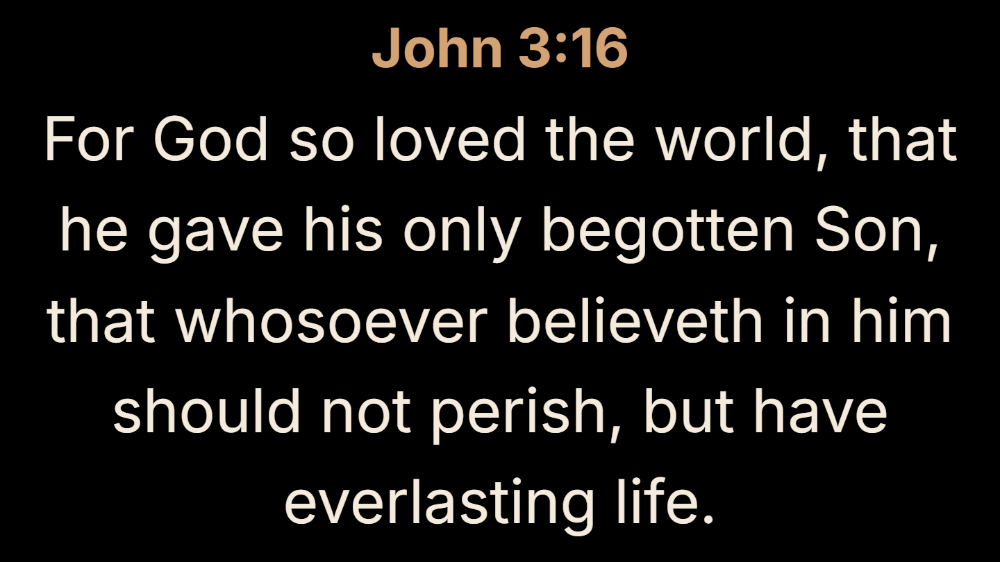
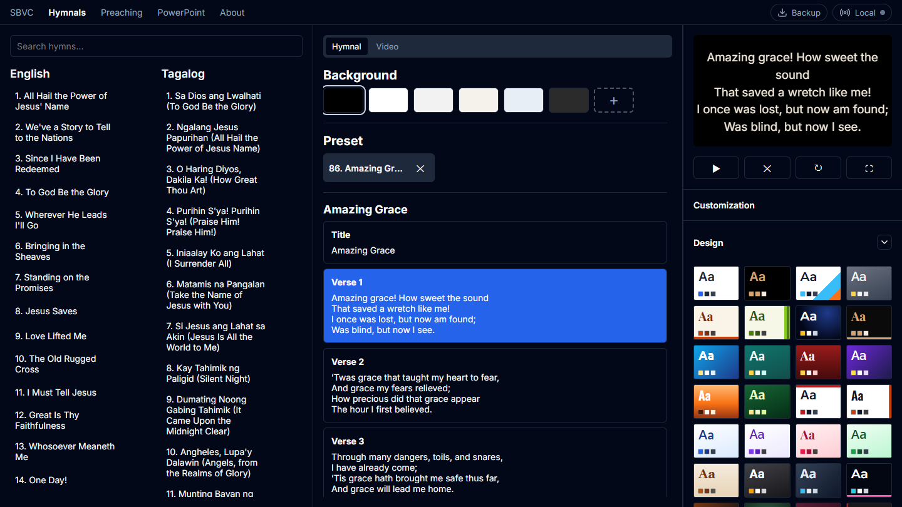
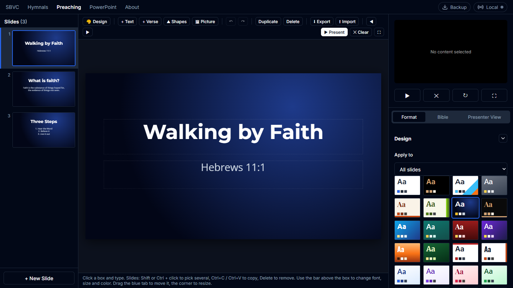
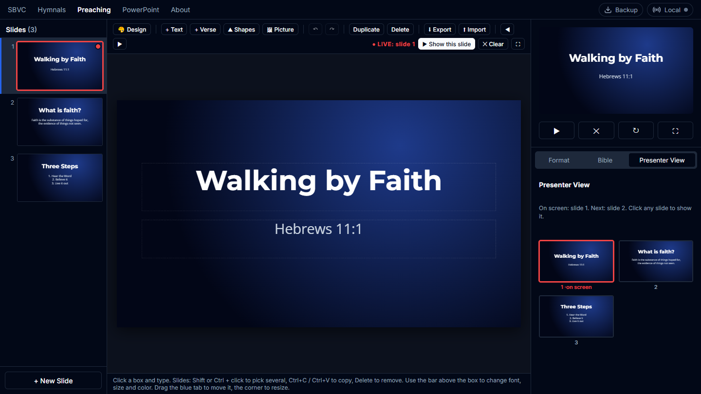
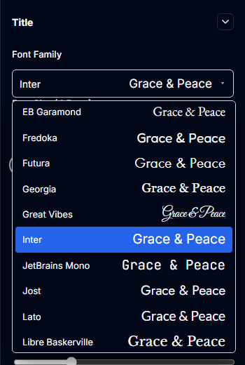
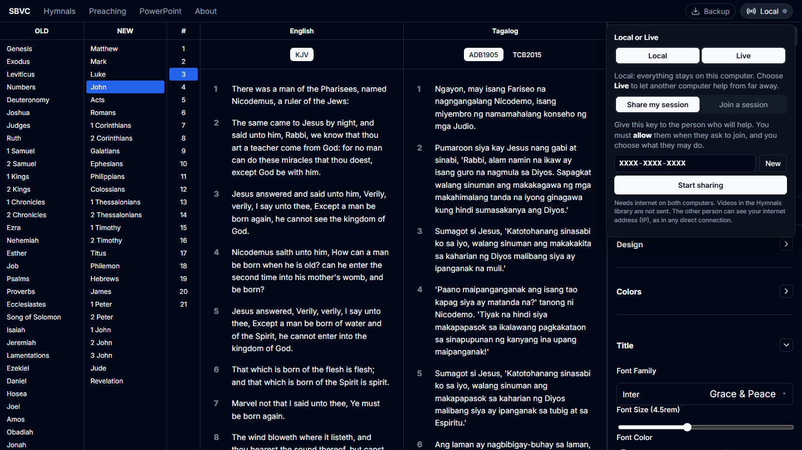
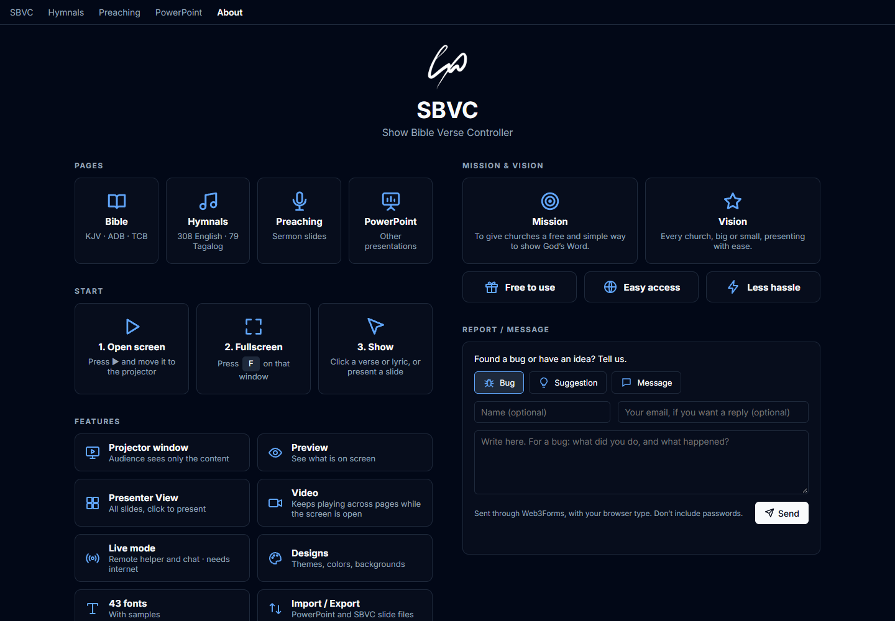

# SBVC – Show Bible Verse Controller

> Your Bible presentation assistant for church services and Bible studies — plain HTML, CSS and JavaScript. No build step, no Node.

**Open it online: <https://sbvc-new.vercel.app>**

> SBVC is still in **development and testing**. Try it before you rely on it in a service, and use **Backup** to keep a copy of your work.



## Contents

[Overview](#overview) · [Tour](#tour) · [Features](#features) · [Technologies](#technologies-used) · [Getting Started](#getting-started) · [Usage](#usage) · [Online Site](#online-site) · [Privacy and Security](#privacy-and-security) · [Project Structure](#project-structure) · [Changelog](#changelog) · [Troubleshooting](#troubleshooting)

## Overview

SBVC lets an operator control what the congregation sees on a projector or second screen. The operator works in the **Controller** window; the audience sees only the clean **Presentation** window (`present.html`).

The two windows talk to each other through the browser's `localStorage` and `storage` events. Verses, hymns and slides are not uploaded to an SBVC server (there is no server code). The only outside services are used by **Live mode** and the **Report / Message** form, when you use them. A tiny PowerShell web server (`tools/serve.ps1`) is included so the pages can be opened from `http://localhost`.

SBVC is the static (plain web files) version of an earlier Next.js project.

## Tour

### What the audience sees

Only the content: no menus and no buttons.



### Hymnals

Search the hymns, add them to the preset, then click the title or a verse to put it on the screen. The **Video** tab plays video and audio files.



### Preaching and PowerPoint

A slide editor with text, verse, shape and picture boxes, plus ready-made designs. The **PowerPoint** tab is the same editor with its own separate slides.



### Presenter View

All your slides in a grid. The one on the screen is marked in red; click any slide to show it.



### Fonts

43 font choices, in A–Z order, each shown in its own style.



### Live mode

Share a key so a helper on another computer can join. The key in this picture is a placeholder.



### About page

A short guide to the pages, steps, features and keys, with the Mission & Vision and the Report / Message form.



## Features

### Bible, hymns and slides

- **Bible controller** – book / chapter / verse lists, three translations (KJV, ADB1905, TCB2015); picking a verse scrolls the same verse into view in the other translation.
- **Bible search** – results are shown a page at a time (1 to 50 per page).
- **Hymnals** – search 308 English and 79 Tagalog hymns, build a preset of up to 15 and project them with their own styling. Also plays video and audio files.
- **Preaching** – a PowerPoint-style editor: draggable slide thumbnails, text / verse / shape / picture boxes, text inside shapes, rich text (style only the words you select), picture cropping, undo / redo, copy / paste, multi-select.
- **PowerPoint tab** – a separate deck with the same editor, for introductions, announcements and other presentations.
- **Presenter View** – every slide in a grid (two per row); click a slide to present it.
- **Import / Export** – save a deck as an `.sbvc.json` file, or export / import a real **PowerPoint (`.pptx`)** file (best effort: text, shapes, pictures and backgrounds come across; animations, charts, SmartArt, videos and gradient-filled shapes do not).

### Look and style

- **30 designs and color schemes** – on the Bible, Hymnals, Preaching and PowerPoint pages, plus your own colors.
- **Customization** – fonts, sizes, colors, text alignment and positions, backgrounds (colors or your own pictures). Panel sections can be opened and closed.
- **43 font choices** – sans serif, slab serif, rounded, serif, headline, script / handwriting, monospaced and Futura style. *Futura* uses the copy installed on your computer; if there is none, the free lookalike Jost is shown.

### On the screen

- **Preview screen** – see what is on the projector at the top of the right-hand panel; the preview matches the projector's layout.
- **The screen stays put** – switching between the Bible, Hymnals, Preaching and PowerPoint pages does not change the projector; it changes only when you click a new verse, hymn line, video or slide (or press Clear).
- **Keyboard and clicker control** – arrow keys or Page Up / Page Down (what presentation clickers send) move to the next or previous Bible verse or hymn part, and Page Up / Down move the slide on the screen.
- **Smooth video** – while the Presentation window is open, it plays the video's sound, so changing controller pages does not pause the video. The **Now Playing** box (play / pause, position, volume, Stop) follows you between the controller pages.
- **Safe projector screen** – text on the presentation window cannot be selected, dragged or right-clicked.

### Helping each other and keeping your work

- **Live mode** – share a session with a key so a helper can join remotely (peer-to-peer over WebRTC). Includes host approval, view / control / edit roles, host controls, a restore point, an activity log and a **live chat** (text, pictures and small files).
- **Remembers your work** – slides, notes and settings survive a refresh or closing the tab.
- **Backup and restore** – the **Backup** button saves everything (slides, pictures, styles, hymn list, notes and videos) to one file and brings it back.

### The website

- **Splash screen** – the Mejez Studio logo animation plays when the home page opens, then the **Open Control Panel** screen appears. Click or press a key to skip it.
- **Tab icon** – the white Mejez Studio signature on a clear background.
- **Link preview** – sending the site's address in apps that support previews (tested in Discord) shows a title, description and picture.
- **Report / Message** – a form on the About page for bugs, suggestions and messages.
- **Clean addresses** – the online site shows `/controller` instead of `/controller.html`.

## Technologies Used

| Area | Technology |
| --- | --- |
| Pages and styling | HTML5, CSS3 |
| Logic | Vanilla JavaScript (IIFE modules on `window.SBVC`) |
| Window-to-window sync | `localStorage` + `storage` events |
| Remote (Live) mode | [PeerJS](https://peerjs.com/) 1.5.4 (WebRTC) |
| `.pptx` export | [PptxGenJS](https://gitbrent.github.io/PptxGenJS/) 3.12.0 |
| `.pptx` import | [JSZip](https://stuk.github.io/jszip/) 3.10.1 |
| Report / Message form | [Web3Forms](https://web3forms.com) |
| Online hosting | [Vercel](https://vercel.com) |
| Local server | PowerShell `HttpListener` (`tools/serve.ps1`) |

The code libraries are stored in `js/vendor/` (with sizes and SHA-256 checksums in `js/vendor/README.txt`) and the fonts in `fonts/` — neither is loaded from a CDN.

## Getting Started

### Use it online

Go to <https://sbvc-new.vercel.app> and click **Open Control Panel**.

### Run it on your computer

You need:

- Windows with PowerShell (included with Windows 10 and later), **or** any other static web server
- A modern browser (Chrome, Edge or Firefox)

1. Download or clone the repository:
   ```powershell
   git clone https://github.com/Mejez6603/SBVC-NEW.git
   cd SBVC-NEW
   ```
2. Double-click **`START.bat`** (it starts the small server on port 8765).
3. Open <http://localhost:8765> in your browser and click **Open Control Panel**.

Not on Windows? Serve the folder with any static server instead, for example:

```bash
python -m http.server 8765
```

> The online site and the copy on your computer keep **separate** saved data. To move your work between them, use **Backup**.

## Usage

1. **Controller** (`controller.html`) – choose a book, chapter and verse.
2. **Presentation** (`present.html`) – click ▶ to open it, drag it to the projector or second monitor, then press <kbd>F</kbd> on that window for fullscreen.
3. **Hymnals** – search a hymn, click **Add**, pick it in the preset, then click the title or a verse.
4. **Preaching / PowerPoint** – build slides, then click **Present** (or click a slide in **Presenter View**).
5. **Export / Import** – use the toolbar buttons; Export asks for an SBVC file or a PowerPoint file, Import asks *Add after my slides* or *Replace all my slides* (Ctrl+Z undoes a replace).
6. **Keys and clicker** – once something is on the screen, press → / ↓ / Page Down for the next verse or hymn part, ← / ↑ / Page Up for the previous one. It also works while the Presentation window is in front, as long as that page is open in the controller window. In Preaching and PowerPoint use Page Up / Down (the arrow keys edit slides there).
7. **Backup** – click **Backup** (top right) before big changes or to move to another computer.
8. **Live mode** – click the **Local / Live** button at the top right. The host shares a key; the helper enters it to join. The host approves each person and chooses their role.

## Online Site

The online site is hosted on Vercel, which publishes it from this GitHub repository when changes are pushed.

| File | What it does |
| --- | --- |
| `vercel.json` | Security headers, and addresses without `.html` (`cleanUrls`) |
| `sitemap.xml`, `robots.txt` | Help search engines find the pages |
| `assets/preview.png` + tags at the top of each page | The link preview |

- **If the web address changes,** update it in the preview tags of the pages, in `sitemap.xml` and in `robots.txt`.
- **Facebook / Messenger** can keep showing an old or empty preview. [Facebook's Sharing Debugger](https://developers.facebook.com/tools/debug/) can ask it to read the page again.
- **Report / Message setup:** the form is set up with a Web3Forms access key in `data-access-key` in `about.html`, so no email address is written in the site. To send the messages somewhere else, get a new key from Web3Forms with that address and replace it. It needs internet.

## Privacy and Security

- Your slides, notes and settings are saved in your own browser.
- **Live mode** uses the free PeerJS broker to introduce two computers; slides and chat then go between them. The other person can see your internet (IP) address. Only share the key with people you trust.
- The **Report / Message** form sends what you type, with your browser type, through Web3Forms. Don't include passwords.
- The online site sends security headers (including a Content-Security-Policy) that limit what the pages can load and connect to.

More in the [Security Policy](SECURITY.md).

## Project Structure

```
SBVC-NEW/
├── index.html          Home page
├── controller.html     Bible controller
├── hymnals.html        Hymnals page
├── preaching.html      Preaching slide editor
├── powerpoint.html     PowerPoint slide editor (separate deck)
├── present.html        Presentation window for the projector
├── about.html          About page and Report / Message form
├── START.bat           Starts the local server on port 8765
├── vercel.json         Security headers and clean addresses for the online site
├── sitemap.xml         List of pages for search engines
├── robots.txt          Tells search engines where the sitemap is
├── UPDATE_LOG.txt      Change history, newest at the bottom
├── css/
│   └── style.css
├── js/
│   ├── state.js        Shared state, the localStorage channel and the font list
│   ├── nav.js          Top menu, Backup and Live buttons
│   ├── backup.js       Back up everything / restore
│   ├── player.js       Video controls on every controller page
│   ├── controller.js   Bible controller logic
│   ├── hymnals.js      Hymnals logic
│   ├── preaching.js    Slide editor (used by Preaching and PowerPoint)
│   ├── slide.js, designs.js, designpanel.js, background.js, custompanel.js, preview.js
│   ├── present.js      Presentation window
│   ├── live.js         Live mode, chat and security
│   ├── pptx.js         .pptx export and import
│   ├── feedback.js     Report / Message form on the About page
│   ├── splash.js       Home page: splash screen and Open Control Panel
│   └── vendor/         PeerJS, PptxGenJS, JSZip (+ README with checksums)
├── fonts/              The fonts, saved locally (+ README)
├── assets/             Splash screen, browser tab icon and link preview picture
├── docs/images/        The pictures in this README
├── logs/               Bible text checking notes
├── data/
│   ├── bible/          kjv, adb, tcb (one file per book)
│   ├── hymns/          English and Tagalog hymns
│   └── books.js
└── tools/
    └── serve.ps1       Small local web server
```

**When changing the code:** put JavaScript in `js/` files, not inside the `.html` pages (no `<script>` blocks with code and no `onclick=` attributes). The online site's security policy in `vercel.json` blocks it, even though it would still work with `START.bat`. The same applies to loading anything from a new outside address: add it to the policy first. Keep the `.html` ending in links between pages, so they also work with `START.bat`.

## Packaging for Distribution

SBVC has no build step, so "packaging" is just copying the folder:

1. Make sure the folder contains the pages and the `css/`, `js/`, `data/`, `fonts/`, `assets/` and `tools/` folders.
2. Zip the **SBVC-NEW** folder (leave out the `.git` folder).
3. On the target computer, unzip it anywhere and double-click `START.bat`.

To host it online, upload the folder to a static host. `vercel.json` only works on Vercel; another host needs its own settings for the security headers and clean addresses. Browsers keep `localStorage` per address, so open the Controller and Presentation pages from the **same** address.

## Future Enhancements

Ideas, not built yet:

- Black screen and logo buttons.
- A warning when saving fails.
- Installing the online site and using it offline.
- Better `.pptx` import (gradient fills, tables as real tables, rotation values).
- More Bible translations and hymn collections.
- A launcher for macOS and Linux.
- More slide designs and transitions.

## Changelog

The dated history is in [`UPDATE_LOG.txt`](UPDATE_LOG.txt) (newest at the bottom). Highlights:

- **2026-11-28** – Online addresses without `.html`; README updated with pictures.
- **2026-11-27** – More fonts, in A–Z menus with samples; fonts saved in the project; backup and restore; keyboard / clicker control; video controls on every page; video no longer pauses when changing pages; splash screen; new tab icon; link preview; security headers; sitemap; new About page with the Report / Message form; TCB Bible text updates.
- **2026-11-26** – The screen stays put when switching pages; Bible and Hymnals previews match the projector; KJV and TCB Bible text updates.
- **2026-11-25** – Designs on the Bible and Hymnals pages; paged Bible search; picture editing and text inside shapes; undo / redo; `.pptx` export and import; PowerPoint tab; Presenter View; Live mode with chat and security hardening; project documents; Bible text updates.
- **2026-11-24** – Preaching editor improvements, including styling part of a text; Bible text updates.

## System Requirements

- A recent version of Chrome, Edge or Firefox
- To run it on your own computer: Windows 10 or later (for `START.bat`), or any OS with a static web server
- Two displays (or a projector) recommended for the Presentation window
- **Run with `START.bat`:** internet is needed only for Live mode and the Report / Message form (fonts and libraries are included)
- **Online site:** needs internet

## Troubleshooting

| Problem | What to try |
| --- | --- |
| `START.bat` closes or the page does not open | Check that port 8765 is free, or run `tools\serve.ps1 -Port 9000` and open that port. |
| Presentation window does not update | Open the Controller and Presentation from the **same address** (both `localhost`, not one `127.0.0.1`). |
| Video sound breaks when changing pages | Open the Presentation window (the ▶ button). If it shows *Click here once...*, click that window once. The Now Playing box should say **Sound: Presentation window**. |
| No video sound | Check the volume and speaker button in the Now Playing box. If there is a **Click to turn the sound back on** button, click it. |
| Clicker or arrow keys do nothing | Put a verse, hymn line or slide on the screen first, and keep that page open in the controller window. |
| Live mode cannot connect | Check both computers are online, the key is typed exactly, and the host has the Live panel open. Some strict networks block WebRTC. |
| A `.pptx` looks different after import | Import is best effort; fonts, animations, charts and gradient shapes may change. |
| The report message does not send | Check your internet, wait a little and try again. Your text stays in the box. |
| Everything looks reset | Check you are using the same browser and address as before. If browser data was cleared, restore from your **Backup** file. |

## Acknowledgment
- GOD
- [PeerJS](https://peerjs.com/), [PptxGenJS](https://gitbrent.github.io/PptxGenJS/) and [JSZip](https://stuk.github.io/jszip/) — the open-source libraries SBVC builds on.
- The developers of the many open-source libraries that made this project possible.
- The communities providing access to the digital Bible texts.
- Pastor Alberto M Mejes
- SBBC
- Mejez
- Dean
- Firelink
- Benz
- Ronigan
- Clod — Bible text updates.
- The original Next.js SBVC project this static version was converted from.
- The churches and volunteers who use and test SBVC.

## Contributing and Policies

- [Code of Conduct](CODE_OF_CONDUCT.md)
- [Security Policy](SECURITY.md)

## License

Released under the [MIT License](LICENSE).

---

Mejez Studio
